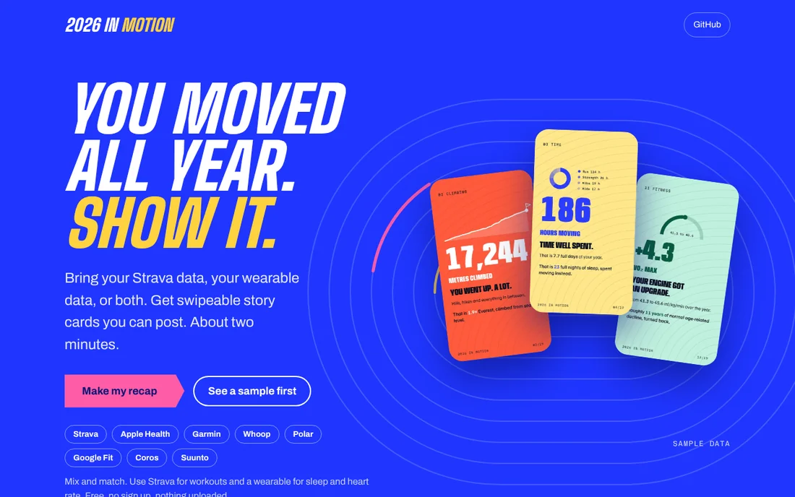
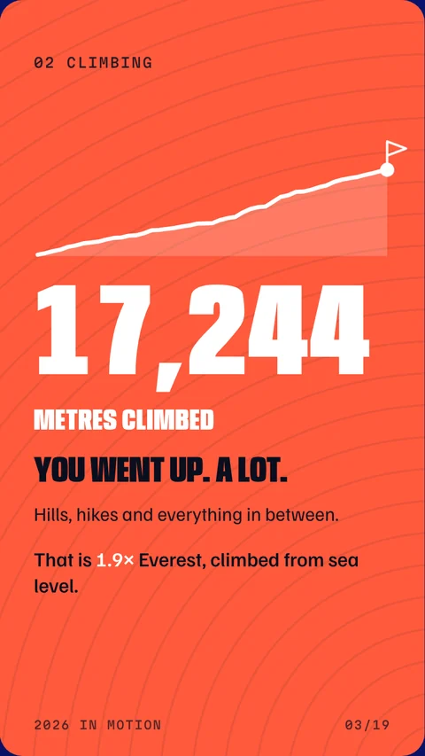
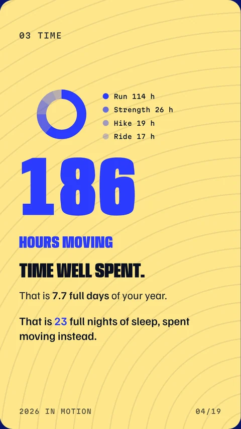
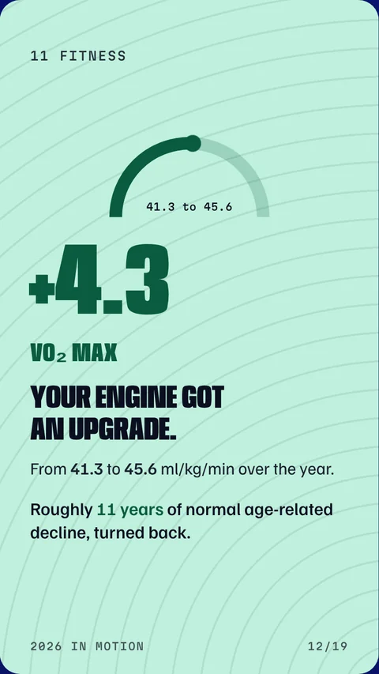

# 2026 in Motion

**Try it: https://frenzytejask98.github.io/Fitness-2026-Recap/**

Your fitness year as swipeable story cards. Bring your Strava data, your wearable data, or both. Free, no sign up, and your files never leave your browser.



<p>



</p>

*Cards shown use sample data.*

A year-in-sport recap that turns your Strava and Apple Health exports into swipeable story cards you can post. It runs entirely in your browser. There is no server, no account, no API key and no subscription.

Drop in your export files, flip through your cards, and save them as 1080 x 1920 images for Instagram Stories.

## How it works

1. Request your data exports (see below).
2. Open the app and click **Use my data**.
3. Drop all your files in at once. The app works out what each file is.
4. Pick a template, swipe through the cards, then **Save card** or **Save all**.

**Your files never leave your computer.** They are read in the page itself. Nothing is uploaded, stored or sent anywhere.

## Getting your data

| Source | How to export | What it gives the recap |
|---|---|---|
| **Strava** | Settings, My Account, Download or Delete Your Account, Request Your Archive. You get a zip by email. Drop the whole zip so the app can read your GPS files. | Workouts, pace, distance, elevation, heart rate, cadence, real personal bests |
| **Apple Health** | Health app, tap your picture, Export All Health Data | VO2 max, resting heart rate, sleep, steps |
| **Garmin** | Garmin Connect, Activities, Export CSV. Or request all your data at garmin.com/account/datamanagement | Workouts. The full export also has more |
| **Whoop** | App, Menu, Data Export | Resting heart rate, sleep, workouts |
| **Polar** | account.polar.com, download your data | Workouts, heart rate |
| **Google Fit** | takeout.google.com, select Fit | Steps |
| **Coros, Suunto, others** | Export workouts as FIT, GPX or TCX, or sync them to Strava and use the Strava export | Workouts |

You can mix sources. For example, Garmin workouts with Whoop sleep and Google Fit steps. If two sources contain the same workout, the duplicate is removed.

Cards that need data you did not provide (say, VO2 max without Apple Health) are left out. The recap is always built from what it finds.

Drop the zip or CSV exactly as you downloaded it. You do not need to unzip anything.

## Instagram

Click **Save card** for the current card or **Save all** for a zip of every card. Images are 1080 x 1920, the Stories size. On a phone, **Save card** opens the share sheet so you can send it straight to Instagram.

Instagram has no web posting for stories, so post from the phone app. (Instagram's own data export does not contain any fitness data, so there is nothing to import from it.)

## Studio mode

Visitors see a clean toolbar. Add `?studio` to the app address (`app.html?studio`) to also get the sample profile picker, the template picker and the **Fact catalog**. This is meant for the person building and tuning the cards.

## Try it without your data

The app ships with five synthetic profiles (steady runner, marathon trainee, cyclist, weekend hiker, couch to 5K). They show how different people get different cards and facts.

## What is inside

- **Card engine.** About 90 facts, 13 athlete types and 11 goals. Each fact has a rule and a score, and the best fit for your numbers wins each slot. The **Fact catalog** view shows every fact, its rule, its value for you, and lets you override the pick.
- **Four templates.** Bold, Night, Sunrise and Receipt, each with its own typography.
- **Animated graphics.** Rings, routes, climbs, heart traces and more, drawn in SVG.

## Run it

It is plain static files. Open `index.html` (the landing page) in a browser. The app itself is `app.html`.

To change the code, edit the files in `src/` and run:

```sh
./build.sh
```

| File | Role |
|---|---|
| `src/landing.html` | The landing page with instructions, built to `index.html` |
| `src/partA.html` | App page shell and all CSS, built with the files below to `app.html` |
| `src/gen.js` | Sample profiles and the metrics calculation |
| `src/facts.js` | The fact catalog, scoring, athlete types and goals |
| `src/deck.js` | Card graphics and card builders |
| `src/importer.js` | Zip reader, Strava CSV and Apple Health parsers |
| `src/sources.js` | Garmin, Polar, Whoop, Google Fit, FIT, GPX and TCX readers, file detection |
| `src/export.js` | Saving cards as PNG and zip |
| `src/ui.js` | Navigation, the data dialog and the catalog view |

## Host it for free

Because it is just static files, anyone can host it for free and share a link:

- **GitHub Pages.** Put the files in a repo, then Settings, Pages, deploy from the main branch. The link is `https://<username>.github.io/<repo>/`.
- **Cloudflare Pages, Netlify or Vercel.** Connect the repo or drag the folder in. No build step is needed.

Visitors land on the instructions page and open the app from there. They only need the link. They do not deploy anything.

## Known limits

- **Years.** The recap covers 2026 and reads only 2026 activity.
- **Fonts.** The page loads fonts from Google Fonts, and the image export fetches them again to embed them. If they cannot load, cards still export, with system fonts.
- **Personal records.** Strava does not put best efforts in its export, so the app finds them itself. With the Strava zip it reads the GPS file of each run of 5 km or more and finds your fastest 5K, 10K and half marathon inside it. If it only gets `activities.csv` (no zip), it falls back to an estimate and the card says so. Reading many GPS files can take a little while.
- **Garmin units.** Garmin's export formats vary by version and account settings. If distances look off, tell us what your file looks like.
- **Coros and Suunto** have no bulk export. Per-workout files or a Strava sync are the way in.
- **Comparisons.** The playful real-world comparisons (distances, heights, times) are approximate.
- **Tested with synthetic files**, built to match each service's documented export format. Real exports may differ. Reports and sample headers (with personal data removed) are welcome.

## Privacy

No analytics, no cookies, no network calls for your data. The only requests the page makes are for fonts.

## License

MIT
